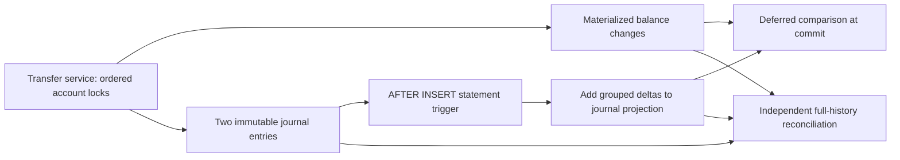

# Latency work: incremental journal projection and fixed-arrival load

## Evidence boundaries

The schema `0004` release completed on 22 October 2026: **147 unit/PostgreSQL tests +
2 real HTTP tests**, **26 frontend tests**, **12 browser tests** against the production Docker
target, migration round trip and ORM drift checks all passed. Statement coverage is **816/867
(94.12%)**. The personal database was backed up, migrated and the local app passed readiness,
UI/assets and authentication-boundary checks. Backup restoration remains untested.

The coding sandbox inspected saved host-terminal artifacts; Docker/PostgreSQL execution happened
on the host. Evidence is preserved under `artifacts/releases/2026-10-22-projection/`.
The first host attempt had 145 passing tests and one fault-injection cleanup failure, archived
separately under `artifacts/releases/2026-10-22-projection-first-run/`. Repairing the projection and
executing its deferred check before re-enabling the guard fixed that cleanup; the full rerun passed.

New measurements are available in [LATENCY_RESULTS.md](LATENCY_RESULTS.md): 7,200 closed-loop
requests, 1,200 profiled transfers and 30,000 fixed-arrival offers. Accounting passed; 11,561
arrivals were dropped by the generator and the higher traffic targets were not consistently met.
The archived 20 October baseline remains separate. Differences between these runs do not establish
a controlled end-to-end speedup attributable solely to the projection.

## The original cost

Both deferred balance triggers called `SUM(amount)` over an affected account's entire journal.
An index locates the account's entries, but summing them still visits `Eₐ` historical rows. Repeated
account/entry events could repeat that scan within one transfer. This made write validation depend
on account age, even though the financial operation touches only two accounts and two new entries.

The existing timing samples did not isolate that cost or establish a scaling law. The algorithmic
issue is visible in migration `0001`; its magnitude must be measured on the target environment.

## Incremental projection without removing the financial checks

Migration `0004` adds a private `accounts.ledger_balance` column. The application continues to
calculate and validate `accounts.balance` using integer cents under ordered row locks. PostgreSQL
maintains the new projection exclusively from inserted journal entries.



The statement trigger uses a PostgreSQL **transition relation** containing only the rows actually
inserted by that statement. It groups their amounts by account, orders accounts by UUID and adds
each delta to the projection. Ignored `ON CONFLICT DO NOTHING` rows contribute nothing. The existing
deferred account and entry triggers now compare the materialized balance and projection by primary
key instead of recomputing historical sums. Transfer pairing, immutability, ownership, bounds,
nonnegative customer balances and completed idempotency checks remain in place.

The reasoning is inductive:

1. Existing accounts start with a projection equal to their verified journal total. New accounts
   start at zero.
2. Inserting an amount changes the journal total and its projection by the same exact amount, in
   the same database transaction.
3. Journal updates/deletes are rejected. Direct changes to the projection, including changing both
   balances together, are rejected by its guard trigger.
4. Commit requires the service's balance to equal that projection; rollback and savepoints undo
   both the journal and projection changes.

`NUMERIC` stores the private projection exactly; its inputs are integer `BIGINT` cents. It allows
intermediate statement totals without narrowing the original deferred-validation semantics to
machine-integer overflow behavior. Public balances and amounts remain bounded `BIGINT` integers;
there is no floating-point monetary calculation. The private column is deferred in the ORM and is
not added to customer account responses.

The guard accepts projection changes only at trigger nesting depth two: the journal statement
trigger updating an account fires the guard one level below it. That assumption is specific to
this schema; adding account-writing triggers requires reviewing it. It is not protection against
a database owner who can replace/disable triggers or change schema. No security-definer function
or user-settable flag grants a bypass. A production deployment still needs separated migration
and restricted runtime roles.

### Complexity and trade-offs

| Path | Previous behavior | Schema `0004` |
|---|---|---|
| Two-entry transfer projection | Repeated sum over `Eₐ` historical entries | Group two new entries; update two account rows |
| Deferred balance comparison | History scan + sum | Account primary-key lookup, approximately `O(log A)` |
| Batched insertion of `k` entries | Historical scans for affected events | Aggregate only `k` inserted rows; ordered account updates; grouping/sort cost is plan dependent |
| Double-entry validation | Indexed checks of transfer entries | Preserved |
| Independent reconciliation | Full journal aggregation | Preserved, also compares the private projection |
| Storage/write cost | One materialized balance | One extra exact numeric per account and additional row updates/WAL |

Writes are not claimed to be universally constant-time: B-tree height, MVCC, lock waits, WAL,
commit synchronization and the number of inserted rows still matter. For shallow histories the
additional updates may cost more than the eliminated scan. A shared source still serializes
spending; this optimization does not bypass its lock or make one balance independently writable.

## Migration and recovery

Upgrade takes an exclusive lock on the financial tables, independently checks existing balances
against the journal, then backfills only the derived projection. A discrepancy aborts the migration;
no materialized balance is repaired. Startup refuses to serve the API if migration fails. This is
a maintenance-window migration whose duration grows with existing data, not a zero-downtime change.

Downgrade to `0003` restores the full-history validation function and removes the derived column.
Money, journal rows, reversal metadata, users and idempotency records are preserved. Tests cover
funded-account round trips and an intentionally corrupted pre-migration balance. Never run the
destructive migration test utility against a personal or hosted database.

Reconciliation still aggregates immutable entries in one MVCC snapshot. It reports both
`mismatched_accounts`/`discrepancies` and the additive fields
`projection_mismatched_accounts`/`projection_discrepancies`. A mismatch in either makes
`consistent=false`. Each detail list is capped at 100 while counts cover all accounts; no automatic
repair is performed. The administrative UI displays both discrepancy types.

## Reproduce correctness, then measure

For one serial command that also backs up and updates the personal Docker app after all checks,
use `ENABLE_DEV_FUNDING=true bash scripts/release_local.sh --full-profile` as described in
[LOCAL_DEPLOYMENT.md](LOCAL_DEPLOYMENT.md). The individual measurement steps are below.

Run serially from LedgerX, with PostgreSQL available. The personal application can remain stopped;
do not run other benchmark/browser commands concurrently against `ledgerx_bench`.

```bash
bash scripts/verify_local.sh
bash scripts/verify_latency.sh --quick  # first check of the measurement pipeline
bash scripts/verify_latency.sh          # full experiment for presentation
# Optional graphs: use the existing analysis environment with Matplotlib.
MPLCONFIGDIR="$PWD/.runtime/matplotlib" python3 -m analysis.render_latency
# After correctness/performance review, rebuild and verify the production container:
bash scripts/verify_web.sh --container
```

The latency runner provisions only a guarded `_bench` database, starts its own API on loopback
port **8003**, then stops that process on exit. It refuses an occupied port. Files stay under the
project. No new cloud account, paid service, Python package or global installation is required.

| Experiment | Full-run settings | Measures |
|---|---|---|
| Closed-loop comparison | Reads, independent/shared transfers and replays; 1/8/32 clients; 200 timed requests; three repetitions | Same workload definitions as the archived baseline, new source digest |
| Service/commit profiling | 0/100/1,000/10,000 prepared transfers; 100 measured transfers; three fresh fixture repetitions per depth | Service duration, commit duration, cursor calls, RSS and exact final-state checks |
| SQL access paths | `EXPLAIN (ANALYZE, BUFFERS)` at each depth | Historical `SUM` versus projection lookup, plus offset/cursor history reads |
| Fixed-arrival HTTP | 100/300/600 offered requests/s; 5 seconds; three repetitions; independent/shared sources; 128 in-flight cap | Scheduled-to-completion latency, request duration, dispatch lag, drops and errors |

Commit timing includes session transaction exit and deferred database checks. It is not a pure
trigger timer or fsync timer. cProfile adds overhead. The isolated read-query comparison does not
measure a complete before/after transfer; it must not be presented as an end-to-end speedup.

The new generator schedules arrival `i` at `t₀ + i/rate` independently of previous responses. Its
in-flight cap bounds active tasks. An arrival over the cap, or more than 100 ms late at admission,
is counted as dropped; the generator does not postpone it until the server becomes free. Each
sent request records dispatch-to-completion and scheduled-to-completion latency. Drops have
`null` latency, not an invented zero or timeout. Tail percentiles cover sent requests and must be
read alongside drops/errors and offered load. Client-side scheduling pressure is visible rather
than silently removed from the result.

Every case checks expected monetary effects for acknowledged requests and independently reconciles
the whole ledger. An unknown response can have committed; the runner does not automatically retry
it or claim exact accounting from acknowledged responses alone. A completed experiment can find
unmet load targets: read `target_met`, `all_targets_met` and the drop counts, not only the process
exit status. An unmet target is not automatically a financial-integrity defect.

Fixed arrivals do not model bursts, Poisson arrivals or long-running traffic. Local generation
shares host resources with the server. Compare source digests, schema, parameters, database state,
CPU allocation and background activity before discussing a performance difference. No maximum
user count, trading-system latency claim or production SLO is inferred from these short runs.
Warmup uses a setup client; the asynchronous load client establishes its own connections during
the measured phase, then reuses them. Initial connection costs are included in those samples.

PostgreSQL references: [transition relations and constraint triggers](https://www.postgresql.org/docs/16/sql-createtrigger.html),
[trigger execution order](https://www.postgresql.org/docs/16/trigger-definition.html),
[trigger nesting depth](https://www.postgresql.org/docs/16/functions-info.html).
